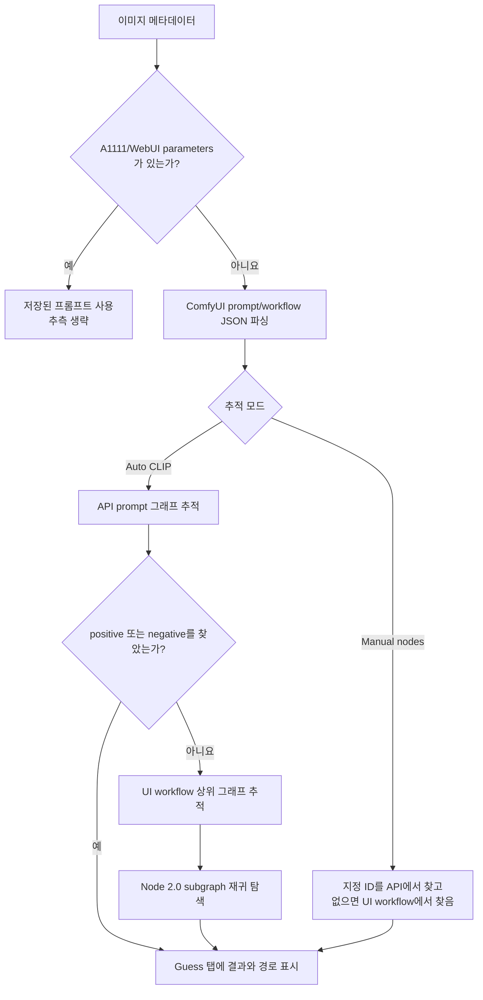

# 워크플로우 프롬프트 추적 지원 및 확장 가이드

이 문서는 ComfyUI 이미지에 저장된 API `prompt`와 UI `workflow`에서 positive/negative 프롬프트를 추정하는 현재 규칙을 설명합니다. 지원 노드를 추가하거나 회귀 원인을 확인할 때 사용하는 개발자용 기준 문서입니다.

- 구현: [`comfy_workflow_prompts.py`](../comfy_workflow_prompts.py)
- 회귀 테스트: [`tests/test_workflow_prompt_inference.py`](../tests/test_workflow_prompt_inference.py)
- 사용자 안내: [`README.md`](../README.md)

## 범위와 지원 수준

추적기는 ComfyUI를 실행하거나 커스텀 노드를 import하지 않습니다. 이미지에 직렬화된 JSON과 문자열만 읽습니다. 따라서 “노드 팩 지원”은 설치된 노드 팩의 모든 버전을 의미하지 않고, 아래에 적힌 저장 계약을 인식한다는 뜻입니다.

| 수준 | 의미 |
| --- | --- |
| 자동 회귀 확인 | 저장 계약을 재현한 테스트 fixture가 있고 positive/negative 결과를 검증함 |
| 패턴 호환 | 일반 규칙과 저장 계약이 맞으면 처리할 수 있지만 해당 노드 팩 전용 fixture는 없음 |
| 미지원 | 실행 결과가 저장되지 않거나 현재 그래프 정보만으로 의미를 구분할 수 없음 |

새 노드를 “지원됨”으로 문서화할 때는 최소한 자동 회귀 테스트를 추가하는 것을 원칙으로 합니다.

## 전체 데이터 흐름

`Workflow prompt guess`는 기본값이 OFF입니다. 뷰어는 A1111/WebUI `parameters`가 이미 있으면 정확한 저장값을 우선하고 추측을 건너뜁니다.



자동 모드에서 API `prompt` 결과가 하나라도 있으면 그 결과를 사용합니다. API 경로에서 아무 텍스트도 찾지 못했을 때만 UI `workflow` 결과로 대체합니다. 두 결과를 필드별로 병합하지는 않습니다.

## 입력 그래프 형식

### API prompt

- 노드는 ID를 키로 하는 객체입니다.
- 노드 타입은 `class_type`, 값과 링크는 `inputs`에 저장됩니다.
- 링크는 보통 `["node_id", output_index]` 형식입니다.
- UI `workflow`도 함께 있으면 동일한 노드 ID의 출력 이름을 스키마 힌트로 사용합니다.

### UI workflow

- 노드는 `nodes` 배열에 저장되고 `id`와 `type`을 사용합니다.
- 기존 링크는 `[id, origin_id, origin_slot, target_id, target_slot, type]` 배열입니다.
- Node 2.0 링크는 `id`, `origin_id`, `origin_slot`, `target_id`, `target_slot` 필드를 가진 객체일 수 있습니다.
- Node 2.0 서브그래프는 `definitions.subgraphs`에서 재귀적으로 탐색합니다. 배열과 ID 기반 객체 저장 형식을 모두 허용합니다.
- 문자열 저장값은 `widgets_values`와 `properties`에서도 읽습니다.

## 자동 추적 순서

### 1. 기준 Sampler 선택

Sampler 후보는 타입 또는 클래스명의 소문자 문자열에 `sampler`가 포함되고 `selector`와 `config`가 포함되지 않은 노드입니다.

- UI 노드의 mode `2`(mute)와 `4`(bypass)는 Sampler 후보에서 제외합니다.
- 다른 Sampler를 upstream에 두지 않은 후보를 먼저 선택합니다.
- 후보가 여러 개면 숫자형 노드 ID가 작은 순서로 선택합니다.
- Node 2.0 서브그래프 인스턴스는 인스턴스 `type`이 서브그래프 ID와 같고 서브그래프 이름에 `sampler`가 있으면 후보가 됩니다.
- 상위 그래프에서 결과가 없으면 각 서브그래프 내부의 Sampler를 순서대로 확인합니다.

Sampler를 찾으면 `positive`와 `negative` 입력 링크를 각각 추적합니다. 두 입력이 없고 `base_ctx`만 있으면 Context 출력 포트 4와 5를 각각 positive와 negative로 해석합니다.

Sampler 경로를 찾지 못한 경우 Text Encode 노드가 정확히 두 개면 첫 번째를 positive, 두 번째를 negative로 사용합니다. 한 개 이상이지만 두 개가 아니면 모두 positive로 표시합니다. 이 동작은 최후의 fallback이며 경고가 함께 기록됩니다.

### 2. API prompt 역추적

API 노드의 처리 우선순위는 다음과 같습니다.

1. `CLIPTextEncode` 계열이면 텍스트 입력을 읽습니다.
2. UI 출력 스키마에서 positive/negative 포트 의미를 찾으면 해당 극성의 입력 키만 읽습니다.
3. Context 노드면 출력 인덱스에 대응하는 입력 또는 `base_ctx`를 따라갑니다.
4. `conditioning`, `positive`, `negative`, `text` 링크를 따라갑니다.
5. 마지막으로 노드 자체의 알려진 텍스트 입력을 읽습니다.

순환 그래프는 `node_id:output_index` 단위 방문 집합으로 중단합니다.

### 3. UI workflow 역추적

UI 노드의 처리 우선순위는 다음과 같습니다.

1. mute 노드는 중단하고 bypass 노드는 대응 입력으로 통과합니다.
2. `GetNode`는 같은 이름의 `SetNode`를 찾고, `SetNode`는 연결된 원본으로 이동합니다.
3. 같은 출력 포트가 `ShowText`에 연결되어 있으면 저장된 표시값을 사용합니다.
4. `CLIPTextEncode` 계열이면 연결된 text 입력을 우선 읽고, 연결값이 없을 때만 widget 저장값을 사용합니다.
5. 출력 이름으로 positive/negative를 구분할 수 있으면 해당 극성의 입력과 가상 연결을 추적합니다.
6. Context 출력이면 대응 입력 또는 `base_ctx`를 추적합니다.
7. `conditioning`, `positive`, `negative`, `text` 입력을 확인합니다.
8. 마지막으로 `widgets_values`의 비어 있지 않은 문자열 또는 `properties`의 알려진 텍스트 키를 사용합니다.

연결된 텍스트가 있으면 같은 노드에 남아 있는 오래된 widget 문자열보다 연결값을 우선합니다.

## 인식하는 텍스트 계약

### 일반 텍스트 입력 키

다음 키는 노드 자체의 텍스트를 수집할 때 사용합니다.

| 용도 | 입력 키 |
| --- | --- |
| 일반 | `caption`, `prompt`, `text`, `string`, `value` |
| positive/negative | `positive`, `negative`, `positive_prompt`, `negative_prompt` |
| 복수 텍스트 | `text_a`, `text_b`, `string_a`, `string_b` |
| SDXL/분리 인코더 | `text_g`, `text_l` |
| 명시적 극성 | `text_positive`, `text_negative`, `text_pos`, `text_neg` |
| 명시적 극성/채널 | `text_pos_g`, `text_pos_l`, `text_neg_g`, `text_neg_l` |
| Wildcard 결과 | `wildcard_text`, `populated_text` |

`string1`, `string_1`, `text1`, `text_1`, `prompt1`, `prompt_1`처럼 `string|text|prompt` 뒤에 숫자가 붙은 키도 처리합니다.

### 극성별 추가 입력 키

출력 포트가 positive/negative로 판정된 경우 다음 키를 우선합니다.

| positive | negative |
| --- | --- |
| `positive` | `negative` |
| `positive_prompt` | `negative_prompt` |
| `text_positive` | `text_negative` |
| `text_pos`, `text_pos_g`, `text_pos_l` | `text_neg`, `text_neg_g`, `text_neg_l` |
| `text` | `text_1` |
| `quality_tags` | `negative_quality_tags` |
| `metadata_prompt` | `metadata_negative_prompt` |

새 별칭을 추가할 때는 일반 키와 극성별 키 중 어디에 속하는지 구분해야 합니다. 일반 키에만 추가하면 다중 conditioning 출력에서 positive와 negative를 정확히 분리하지 못할 수 있습니다.

## 지원 노드와 판정 규칙

| 범주 | 현재 판정 규칙 | 대표 노드/계약 | 수준 |
| --- | --- | --- | --- |
| Sampler | 이름에 `sampler` 포함, `selector`/`config` 제외 | `KSampler` 및 Sampler 계열 | 자동 회귀 확인 |
| CLIP encoder | 이름에 `cliptextencode` 포함 | `CLIPTextEncode`, `CLIPTextEncodeSDXL` | 자동 회귀 확인 |
| 일반 Text Encode | 구두점을 제거한 이름에 `textencode` 포함 | Wildcard Text Encode와 유사한 노드 | 자동 회귀 확인 |
| Context | 타입 이름 또는 UI 출력 이름/타입에 `context` 포함 | rgthree `Context Big`, `base_ctx` | 자동 회귀 확인 |
| 다중 conditioning loader | UI 출력 이름으로 극성 판정 | Efficiency Loader `CONDITIONING+`/`CONDITIONING-` | 자동 회귀 확인 |
| Set/Get | 정규화한 타입이 `setnode`/`getnode`로 끝남 | KJNodes Set/Get 저장 계약 | 자동 회귀 확인 |
| Bypass | UI mode `4`와 입출력 위치/이름/타입 대응 | bypass된 문자열·conditioning 노드 | 자동 회귀 확인 |
| Text concat | 타입명에 text/string concatenate 패턴 포함 | Comfyroll `CR Text Concatenate`의 API prompt 계약 | 자동 회귀 확인 |
| 번호형 문자열 결합 | 번호형 string/text/prompt 입력 수집 | RvTools/범용 merge 계열과 유사한 계약 | 패턴 호환 |
| 표시 결과 | 정규화한 타입명에 `showtext` 포함 | pysssss `ShowText` | 자동 회귀 확인 |
| Wildcard 저장 결과 | `populated_text` 또는 `wildcard_text` 입력 | Impact/Inspire와 유사한 populated prompt 계약 | `populated_text` 자동 회귀 확인, `wildcard_text` 패턴 호환 |
| Node 2.0 | `definitions.subgraphs`와 객체형 링크 | 상위 Sampler subgraph 및 내부 Sampler | 자동 회귀 확인 |
| 일반 문자열 노드 | 알려진 input/widget/property 문자열 | `PrimitiveString`, `PrimitiveStringMultiline` | 자동 회귀 확인 |

### 출력 포트의 positive/negative 판정

UI 출력의 `name`과 `label`을 합쳐 다음 순서로 판정합니다.

- `CONDITIONING-` 또는 `cond-`: negative
- `CONDITIONING+` 또는 `cond+`: positive
- 토큰 `negative` 또는 `neg`: negative
- 토큰 `positive` 또는 `pos`: positive
- 토큰 `prompt`, `quality` 또는 `qualitytags`: positive

API prompt만으로는 다중 출력 Loader의 출력 이름을 알 수 없는 경우가 있습니다. 이때 같은 이미지의 UI `workflow`가 있어야 출력 인덱스를 positive/negative로 구분할 수 있습니다.

### Context 출력 인덱스

현재 Context 포트는 rgthree 계열의 위치 계약을 기준으로 합니다.

| 출력 인덱스 | 입력 키 |
| ---: | --- |
| 0 | `model` |
| 1 | `clip` |
| 2 | `vae` |
| 3 | `latent` |
| 4 | `positive` |
| 5 | `negative` |
| 6 | `seed` |
| 7 | `steps` |
| 8 | `step_refiner` |
| 9 | `cfg` |
| 10 | `sampler` |
| 11 | `scheduler` |

프롬프트 추적에서 직접 사용하는 포트는 주로 4와 5입니다. 다른 순서를 사용하는 Context 노드는 출력 이름 기반 규칙 또는 별도 테스트가 필요합니다.

### Set/Get 이름과 타입

- 타입의 공백과 기호를 제거한 소문자 값이 `setnode` 또는 `getnode`로 끝나야 합니다.
- 연결 이름은 첫 번째 문자열 widget을 사용하고, 없으면 `properties.previousName`을 사용합니다.
- 같은 이름의 Set이 여러 개면 저장 순서상 마지막 항목이 선택될 수 있으므로 이름은 고유해야 합니다.
- 극성별 가상 입력 탐색에서는 출력 타입에 `STRING`, `CONDITIONING` 또는 `CONTEXT`가 포함된 Set/Get만 후보로 사용합니다. 설정 JSON이나 숫자 버스가 프롬프트에 섞이는 것을 막기 위한 제한입니다.

### 문자열 결합

타입명을 정규화했을 때 다음 패턴 중 하나가 있으면 concat 노드로 봅니다.

- `textconcatenate`
- `concatenatetext`
- `stringconcatenate`
- `concatenatestring`

API prompt의 `separator`가 문자열로 저장되어 있으면 그 값을 사용합니다. UI-only workflow와 그 외 번호형 입력은 현재 기본적으로 줄바꿈으로 결합합니다.

### ShowText 저장값

추적 중인 정확한 출력 포트가 `ShowText` 계열 노드에 연결되어 있으면 그 노드의 첫 번째 저장 문자열을 실행 결과 캐시로 사용합니다. 이는 실행 시 만들어진 문자열을 복원하는 가장 정확한 경로일 수 있지만, 워크플로우를 실행한 뒤 다시 저장하지 않았다면 오래된 값일 수도 있습니다.

## 알려진 한계와 오판 가능성

- 실행 시점에만 존재하고 `prompt`, `workflow`, widget, property, `ShowText` 어디에도 저장되지 않은 문자열은 복원할 수 없습니다.
- API 추적이 positive 또는 negative 중 하나만 찾아도 UI 추적으로 필드별 보완하지 않습니다.
- UI 출력 스키마가 없는 API-only 이미지에서는 다중 conditioning Loader의 극성을 잘못 판단할 수 있습니다.
- 첫 Sampler 선택은 그래프 upstream 관계와 노드 ID를 기준으로 하므로 사용자가 의도한 최종 Sampler와 다를 수 있습니다.
- generic widget fallback은 추적 경로에 있는 문자열을 수집하므로 프롬프트가 아닌 문자열이 섞일 가능성이 있습니다.
- 고정 포트 순서가 다른 Context 노드는 rgthree 방식으로 해석하면 잘못된 입력을 선택할 수 있습니다.
- `Manual nodes`도 지정 노드의 텍스트가 알려진 input/widget/property 계약에 저장되어 있어야 합니다.

결과에는 source node ID와 경고를 남겨 사용자가 추정 경로를 검토할 수 있게 해야 합니다. 불확실한 값을 확정 메타데이터처럼 `Prompt` 탭에 덮어쓰지 않습니다.

## 새 노드 지원 절차

### 1. 실제 저장 계약 확보

스크린샷이나 노드 이름만으로 구현하지 말고 다음 자료를 확보합니다.

- 이미지에 저장된 API `prompt` JSON
- 가능하면 같은 이미지의 UI `workflow` JSON
- 해당 노드의 `class_type`/`type`
- 프롬프트 입력 키와 값 또는 링크
- 출력 포트 이름, 인덱스와 타입
- `widgets_values`/`properties`에 저장되는 실행 결과
- mute, bypass, Set/Get, subgraph 사용 여부

개인 경로, 모델명, 프롬프트는 최소화하거나 익명화한 fixture를 만듭니다.

### 2. 가장 좁은 규칙 선택

다음 순서로 기존 규칙 재사용 가능성을 확인합니다.

1. 기존 텍스트 입력 키만 추가하면 되는가?
2. 출력 이름으로 positive/negative를 구분할 수 있는가?
3. 기존 Text Encode, Context, concat, Set/Get, ShowText 패턴과 같은가?
4. 링크 형식이나 서브그래프 형식만 추가하면 되는가?
5. 위 방법으로 불가능할 때만 노드 전용 분기를 추가합니다.

클래스명 하나를 하드코딩하기보다 안정적인 입력·출력 저장 계약을 우선합니다. 단, 일반화가 다른 문자열 노드까지 오인하게 만들면 노드 전용 규칙이 더 안전합니다.

### 3. 구현 위치

| 변경 종류 | 주요 위치 |
| --- | --- |
| 새 텍스트 키 | `TEXT_INPUT_KEYS`, `POSITIVE_TEXT_INPUT_KEYS`, `NEGATIVE_TEXT_INPUT_KEYS` |
| 새 노드 종류 판정 | `_is_*_node` helper |
| API 경로 | `_trace_api_conditioning_to_text`, `_api_node_text` |
| UI 경로 | `_trace_ui_conditioning_to_text`, `_ui_node_text` |
| 출력 극성 | `_ui_node_output_polarity`, `_label_polarity` |
| 링크/서브그래프 | `_ui_link_parts`, `_iter_ui_subgraphs` |
| Set/Get·bypass | `_ui_virtual_*`, `_ui_bypass_source_refs` |

### 4. 회귀 테스트

최소한 다음을 확인합니다.

- positive와 negative가 서로 다른 값으로 정확히 분리되는가?
- API prompt만 있는 경우와 UI workflow가 함께 있는 경우의 차이가 명확한가?
- 연결된 최신 문자열이 오래된 widget보다 우선하는가?
- mute/bypass 또는 Set/Get을 사용한다면 원본까지 도달하는가?
- 출력 인덱스가 여러 개인 경우 잘못된 포트를 읽지 않는가?
- Node 2.0 전용이라면 객체형 링크와 subgraph를 재현했는가?
- 순환 링크가 무한 재귀를 만들지 않는가?
- 기존 기본 Sampler/CLIP 테스트가 그대로 통과하는가?

테스트 이름에는 노드 팩 이름보다 검증하는 저장 계약을 드러내는 표현을 함께 사용합니다.

### 5. 문서 갱신

- 사용자에게 의미가 있는 지원 범위는 `README.md` 표에 추가합니다.
- 정확한 판정 규칙과 지원 수준은 이 문서의 표에 추가합니다.
- 전용 fixture가 없으면 “자동 회귀 확인”으로 표시하지 않습니다.
- 특정 버전에서 저장 계약이 달라졌다면 버전 범위와 차이를 기록합니다.

## 검증 명령

프롬프트 추적 테스트:

```bat
.venv\Scripts\python.exe -m unittest tests.test_workflow_prompt_inference -v
```

전체 테스트와 문법 검사:

```bat
.venv\Scripts\python.exe -m unittest discover -s tests
.venv\Scripts\python.exe -m compileall -q comfy_workflow_prompts.py comfy_metadata_reader.py comfy_exif_viewer.py tests
git diff --check
```

문서만 바꾼 경우에도 상대 링크, 파일 경로, 코드에 정의된 입력 키와 지원 표가 일치하는지 확인합니다.
